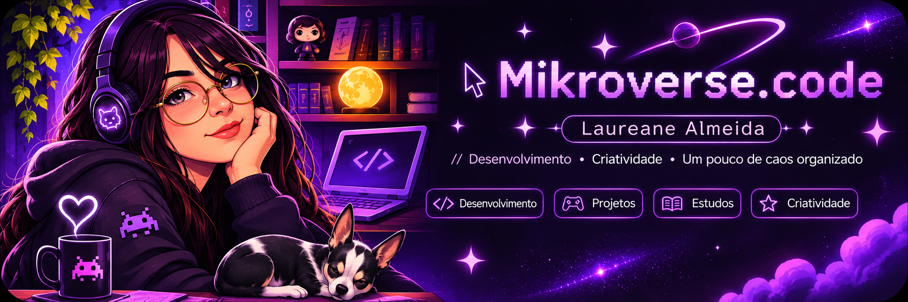

<div align="center">



<br>


</div>

<br>

###  Sobre mim

Oi! Eu sou a **Lau**, tenho 23 anos e sou formada no técnico em **Desenvolvimento de Sistemas**.

Sempre gostei de tecnologia, mas foi na programação que encontrei uma forma de juntar duas coisas que adoro: **criar e descobrir como tudo funciona**.

Gosto de desenvolver sistemas, montar interfaces e transformar ideias em projetos reais. Tenho explorado tanto o front-end quanto o back-end, aprendendo bastante no processo (e quebrando a cabeça com alguns bugs também).

Ainda estou construindo meu caminho na área e procurando minha primeira oportunidade como desenvolvedora.

Quando não estou programando, provavelmente estou jogando, ouvindo música ou pensando em alguma ideia nova que vou querer colocar em prática.

<br>

###  No momento

```text
formação       Desenvolvimento de Sistemas
foco           Desenvolvimento Web / Full Stack
estudando      React, Python, APIs e Banco de Dados
objetivo       Primeira oportunidade como Dev
```

<br>

###  Tecnologias

<div align="center">

<h4>Linguagens</h4>


<br>

<h4>Frameworks e bibliotecas</h4>


<br>

<h4>Bancos de dados e ferramentas</h4>


</div>

<br>

###  Além do código

Nem tudo por aqui é programação. Também gosto de:

- **Games:** principalmente quando encontro um jogo que me prende por horas.
- **Música:** minha companhia para quase tudo.
- **Pixel art e galáxias:** duas coisas que acabaram virando parte da identidade do Mikroverse.code.
- **Design:** gosto de pensar nos detalhes de uma interface, não só no código por trás dela.
- **Novas ideias:** tenho o costume de imaginar um projeto antes mesmo de terminar o anterior.

<br>

###  Onde me encontrar

<div align="center">

<a href="https://www.instagram.com/laureane_almeida/">
  
</a>
<a href="https://github.com/laureaneal">
  
</a>

</div>

<br>

---

<div align="center">

### ✦ Mikroverse.code ✦

<sub>Um pedacinho do meu universo, entre códigos, jogos e ideias.</sub>

</div>
